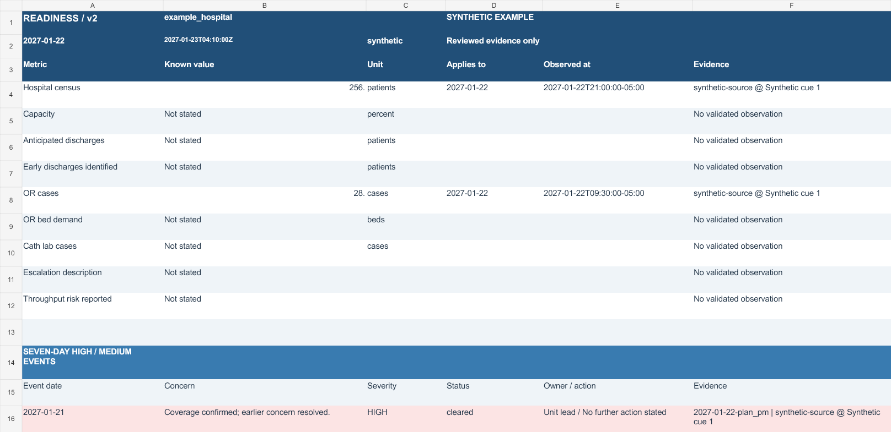

# Hospital Operations Intelligence

**Configurable meeting-to-workbook operations intelligence, with a surgical operations worked example.** Preserve meeting evidence, update the executive view, retain permanent daily records and prepare role-specific briefs.

## Start here

**Open [Start Here](docs/START-HERE.md)** for the leader and technical setup paths. The package includes working local software, Excel templates, Office Scripts, detailed prompt/skill templates and tenant build instructions. Downloading it does not authenticate accounts or install cloud agents.



## What is available

| Capability | Status |
| --- | --- |
| Organizational setup questionnaire | Runnable locally; creates configuration and one extraction template per selected meeting. |
| Reviewed meeting metrics and issues | Typed fields, operating dates, source references, revisions and explicit source status. |
| Executive Snapshot | Refreshed known values with dates; rolling seven-calendar-day HIGH/MEDIUM events, including resolved events until expiry. |
| Master Table | One immutable row per closed date, after configured closing time and meeting processing checks. |
| Meeting and issue history | Dated meeting sheets, append-only issue revisions, source audit and unresolved handoff. |
| OR block context | Versioned dated schedule with previous surgeon session and prior-month matching block lookbacks. |
| Local refresh worker | Imports reviewed files, refreshes workbook payloads and attempts daily close. Requires an approved running computer. |
| Microsoft connections | Detailed tenant configuration recipes, action/connection maps and a clearly labeled optional API scaffold. Not deployed automatically. |
| Executive and frontline briefs | Full reusable prompts and skills. AI execution, notifications and spoken delivery require optional configured services. |
| Department federation | Optional architecture guidance, not a deployed shared multi-agent service. |

## Templates and complete walkthrough

- [Readiness workbook quickstart](docs/READINESS-QUICKSTART.md)
- [Blank operational workbook](templates/Daily%20Operational%20Readiness.xlsx)
- [Populated synthetic workbook](assets/Readiness%20Synthetic%20Example.xlsx)
- [Organization onboarding](docs/ONBOARDING.md)
- [Full workflow and record rules](docs/WORKFLOW-SPECIFICATION.md)
- [Automation setup](docs/AUTOMATION-SETUP.md)
- [Validation and acceptance](docs/VALIDATION.md)
- [Source-design traceability](docs/SOURCE-TRACEABILITY.md)

Use approved Python 3.11+ and named-timezone support (Windows may need approved `tzdata`). From the extracted repository:

```powershell
python -m hospital_ops.configure
python -m hospital_ops.readiness_demo
```

The first command asks local setup questions; the second creates an isolated invented example. Neither reads your email/calendar or sends messages.

## Connection to staffing and charge handoff

[Charge Nurse Handoff Dashboard](https://github.com/true2thecore-cloud/charge-nurse-handoff-dashboard) remains the frontline companion for Forms, staffing and assigned hours. Its staffing export preserves A1:L46 and Friday-to-Monday date handling. [Companion connection](docs/COMPANION.md) explains the bridge. Private repository links require owner-granted access.

The new readiness workflow uses version-2 reviewed records and a dedicated readiness database. The earlier version-1 VTT/workbench/issue-pattern engine remains available through [Portable setup](docs/PORTABLE-SETUP.md), [Microsoft setup](docs/MICROSOFT-365.md) and [Data contracts](docs/DATA-CONTRACTS.md). Their record formats are distinct. Do not relabel an old review as version 2; map and review the additional metric/source fields explicitly.

## Validation and boundaries

```powershell
python -m unittest discover -s tests -v
node --test tests/office.test.mjs tests/readiness-office.test.mjs
```

Examples are synthetic. Local tests and workbook rendering do not verify live tenant permissions, cloud flows or production outcomes. Historical associations are context, not validated forecasts. Source records and operational identities stay in organization-approved private storage, outside Git. The local stores are single-writer, not a hospital-wide hosted service.

MIT licensed. Version 0.2.0. [Change log](CHANGELOG.md).
