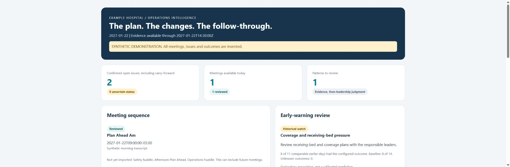
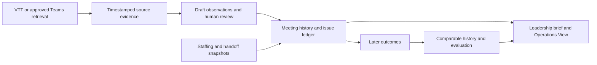

# Hospital Operations Intelligence

**A configurable meeting memory and follow-through system for hospital leaders.** Connect morning plans, afternoon updates, staffing snapshots and charge nurse handoffs. Preserve the evidence, carry unresolved concerns forward, and examine which combinations of concerns preceded later outcomes.

Companion: [Charge Nurse Handoff Dashboard](https://github.com/true2thecore-cloud/charge-nurse-handoff-dashboard). Both repositories are initially private for owner review. Links require access until their owner publishes them.



## Try the complete example

Download this repository with **Code → Download ZIP**, extract it, and open a terminal in the extracted folder. Use Python 3.11 or newer, approved for your environment. The core has no third-party Python dependencies.

```powershell
python -m hospital_ops demo
```

Open `data/demo/brief.html`. The demo creates 15 weekdays of invented meeting evidence, reviewed concerns and later outcomes. All examples use role placeholders. It also creates report JSON, a CSV issue register and an exploratory evaluation report.

For a browser-based workbench:

```powershell
python -m hospital_ops --config data/demo/site.json --db data/demo/operations.sqlite serve
```

Open `http://127.0.0.1:8765` and select **2027-01-22** for the demonstration. Do not put real data in the synthetic database.

## What is included

| Capability | Included behavior |
| --- | --- |
| Configurable meeting sequence | Safety huddle, 9 AM Plan Ahead, 2 PM follow-up and operations huddle, with editable times and report-out roles. |
| Transcript intake | Manual VTT upload, command-line import, approved-folder watcher and optional Microsoft Graph retrieval for a specified meeting. |
| Evidence review | Timestamped cues, speaker attribution when present, keyword mention suggestions, and human-reviewed structured observations. |
| Operational memory | Local SQLite history, immutable source records, review revisions, stable issue IDs and explicit resolution. |
| Early-warning review | Configured combinations of confirmed signals, earlier comparable-day counts, baseline counts and missing-outcome counts. |
| Evaluation | Chronological walk-forward evaluation using only evidence available at each checkpoint. |
| Reports | Self-contained HTML brief, report JSON, Excel-friendly CSV and an Office Script for a dedicated Operations View. |
| Staffing connection | Accepts the companion's A1:L46 staffing snapshot and Forms response-table snapshot. |
| Microsoft setup | Detailed Power Automate, Teams transcript and Copilot Studio instructions with a manual route for restricted environments. |

This release does **not** train an LLM, automatically understand all clinical language, or provide validated outcome probabilities. Keyword matches are review suggestions only. The confirmed structured history supports exploratory comparisons; local outcome definitions and prospective validation are needed before relying on forecasts. [How learning and evaluation work](docs/LEARNING.md).

## Choose your setup

| Your environment | Start here |
| --- | --- |
| You can upload files and run approved Python | [Portable setup](docs/PORTABLE-SETUP.md) |
| You use Microsoft 365 and want automated intake | [Microsoft 365 and Power Automate](docs/MICROSOFT-365.md) |
| You want an agent to draft meeting observations | [Copilot Studio setup](docs/COPILOT-STUDIO.md) |
| Python cannot run in your organization | Use the manual structured meeting templates and your existing Excel dashboard. The full historical engine needs an approved worker or equivalent IT deployment. The repository does not create that permission. |
| You already use the charge nurse dashboard | [Companion connection](docs/COMPANION.md) |

## The daily workflow



The morning meeting identifies constraints and assigns follow-up. The afternoon meeting updates those same issue IDs and records outcomes. A concern is closed only when reviewed evidence says it is resolved. A missing transcript or an unmentioned outcome stays unknown.

## Templates and customization

- [Morning Plan Ahead](templates/morning-plan-ahead.md)
- [Afternoon Plan Ahead](templates/afternoon-plan-ahead.md)
- [Meeting register](templates/meeting-register.csv)
- [Outcome register](templates/outcome-register.csv)
- [Site configuration](config/site.example.json)
- [Reviewed observation example](templates/review.example.json)
- [Customization guide](docs/CUSTOMIZATION.md)
- [Data contracts](docs/DATA-CONTRACTS.md)

Change the hospital label, leader role, department structure, meeting order, signals, outcomes and rule thresholds. Times are examples. The supplied perioperative agendas are an operational structure, not a replacement for local clinical policy.

## Data stays under your control

The portable workbench binds only to `127.0.0.1` and does not send data to an AI provider. Operational files belong in your approved private storage, outside Git. The optional Graph adapter reads transcripts using an access token you obtain through your organization's approved process. Copilot prompts and flow instructions are configuration material, not automatically installed agents or authenticated connections. See [data handling](docs/DATA-HANDLING.md).

## Validate your copy

```powershell
python -m unittest discover -s tests -v
```

For the Office Script behavior tests, use Node.js 24+:

```powershell
node --test tests/office.test.mjs
```

Tests cover timestamped VTT parsing, duplicate protection, evidence validation, review revisions, future-information exclusion, unknown outcomes, staffing date rules, snapshot validation, safe rendering and the synthetic end-to-end workflow. The GitHub workflow runs the core tests on Windows and Linux. Live tenant permissions, Power Automate flows and Graph consent must be tested in your organization.

MIT licensed. Version 0.1.0. [Troubleshooting](docs/TROUBLESHOOTING.md) · [Implementation boundaries](docs/ARCHITECTURE.md).
